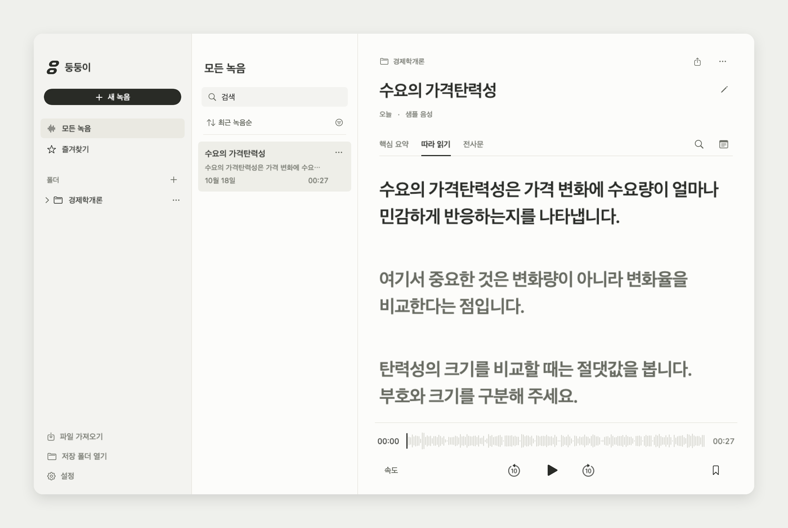
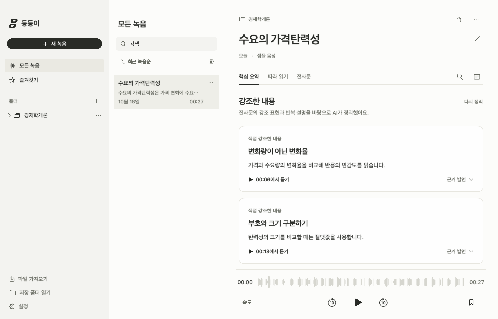

<p align="center">


</p>
<h1 align="center">둥둥이</h1>
<p align="center"><strong>AI 기반의 대학교 강의 녹음 macOS 앱</strong></p>

## AI 구독에 강의 정리 구독까지

클로바노트·다글로 같은 서비스로 강의를 정리하다 보면 무료 제공량을 넘겨 쓰기 위해 별도 구독을 고민하게 됩니다. **Codex나 Claude에 이미 구독료를 내고 있는데, 강의 정리를 위해 구독을 하나 더 추가하는 셈입니다.**

둥둥이는 **내 Mac의 녹음 앱에 기존 Codex를 연결하는 오픈소스 프로젝트**입니다. 강의를 녹음하면 텍스트와 핵심 요약이 같은 기록에 쌓이고, 문장을 클릭해 그 설명을 다시 들을 수 있습니다. 파일을 변환하고 AI 채팅창에 붙여넣는 과정도 앱에서 처리합니다.

**녹음·보관·재생은 계정이나 구독 없이 무료로 사용할 수 있습니다.** 녹음과 정리 결과는 Mac에 보관합니다.

음성 인식은 ChatGPT 받아쓰기 서버, 교정·제목·핵심 요약은 연결한 Codex가 처리합니다. **음성과 텍스트가 서버로 전송되며 인터넷과 ChatGPT 로그인이 필요합니다.** 전사문은 전체 교정을 마친 뒤 보여드립니다.



_화면은 앱의 실제 UI이며, 강의 내용은 소개용 가상 데이터입니다._

## 어떻게 동작하나요?

**녹음하면서 5분씩 파일 전사 → 재생 위치 맞추기 → 전체 교정·핵심 요약 → 문장을 눌러 다시 듣기**

| 단계 | 처리 위치 | 하는 일 |
|---|---|---|
| 녹음·전사 | Mac → ChatGPT | 녹음은 Mac에 저장하고, 약 5분씩 완료된 구간을 파일로 전송해 텍스트를 얻습니다. |
| 재생 위치 | 내 Mac | 음성과 전사문을 대조해 각 문장이 들리는 시간을 찾습니다. |
| 전체 교정 | Codex | 녹음이 끝나면 전체 맥락을 참고해 인식 오류·띄어쓰기·문장부호를 검토합니다. 원래 의미·말투·숫자·반복 표현을 보존합니다. |
| 제목·핵심 요약 | Codex | 강의 주제로 제목을 붙이고, 교수님이 강조한 내용은 근거 문장과 연결한 카드로 정리합니다. |
| 복습·보관 | 내 Mac | 음성, 교정 전후 텍스트, 핵심 요약, 메모를 한 기록으로 보관합니다. |

녹음 종료 후 처음부터 전사하지 않습니다. **녹음 중 처리한 결과를 그대로 사용하고, 마지막 남은 구간만 마무리합니다.** 이미 녹음한 파일을 가져와도 같은 엔진이 처리합니다. 교정이 중단되어도 음성과 처리 기록은 남아 이어서 정리할 수 있습니다.

처리 화면에서 **남은 음성 전사 → 전사문 교정 → 제목·핵심 요약 → 저장** 순서를 확인할 수 있습니다. 전사는 처리한 음성 길이를 보여 주고, 교정은 강의 앞뒤 맥락을 함께 확인합니다. **교정이 끝난 전사문은 요약을 기다리는 동안 먼저 읽고 재생할 수 있습니다.**

노트북을 덮으면 녹음을 일시 정지하고 작업 상태를 저장합니다. 다시 열면 정리 작업은 이어지고, 녹음은 **계속 녹음**을 눌러 재개합니다. 앱이 갑자기 종료됐을 때도 다음 실행에서 저장된 음성을 확인하고 **이어서 정리**할 수 있습니다.

**설정 → AI 공급자**에서 연결 상태, 모델, 추론 강도, 요청별 응답 제한 시간, Codex 실행 경로를 설정합니다. 기본값은 자동 선택·Medium이며, 앱 실행 시 모델 목록을 확인해 GPT-6.1 Sol을 우선하고 없으면 GPT-6 Luna를 선택합니다. 모델을 직접 고를 수도 있습니다. 설정 변경은 다음 작업부터 적용됩니다.

### 연결과 비용

파일 전사에는 Codex CLI에 로그인한 ChatGPT 계정을 사용합니다. 현재 연결은 ChatGPT 내부 받아쓰기 경로이며, 공개 음성 API와는 다릅니다. 정확한 제공량·과금 규칙·지속적인 이용 가능성이 공개되어 있지 않아 무제한 무료라고 약속하지 않습니다.

교정·요약에는 연결한 Codex 계정의 한도가 적용됩니다. 앱이 API 키 결제로 전환하거나 추가 크레딧을 구매하지는 않습니다. **이 한도를 강의 몇 시간으로 고정해서 안내할 수는 없습니다.** 녹음 길이뿐 아니라 발화량과 교정 요청량도 영향을 줍니다.

## 녹음한 강의로 복습하기

### 글을 읽다가 그 설명을 다시 듣기

강의를 재생하면 음악 앱의 가사처럼 현재 문장이 강조됩니다. 문장을 클릭하면 그 설명이 나오는 시점부터 재생합니다. 본문을 드래그하면 여러 문장에 걸쳐 선택하고 복사할 수 있습니다. 이해가 안 된 구간은 반복하고, 다시 볼 곳에는 북마크를 남길 수 있습니다.

예를 들어 전사문에서 ‘가격탄력성’을 찾아 해당 문장을 클릭하면, 교수님이 그 개념을 설명하던 부분을 다시 들을 수 있습니다.

### 강조한 내용은 핵심 요약에서 확인하기

AI가 전사문에서 중요하다고 언급하거나 반복한 설명을 찾아 **핵심 요약** 카드로 정리합니다. 카드에는 요약과 근거 문장이 연결됩니다. 필요한 내용은 선택해서 복사하거나, 카드별·전체 복사 버튼으로 가져갈 수 있습니다. 요약만으로 이해가 안 되면 **해당 구간 듣기**로 원래 설명을 확인할 수 있습니다.



_소개용 가상 데이터입니다. 강조 여부는 전사문을 바탕으로 판단합니다._

### 과목별로 모으고, 필요한 내용 가져가기

**새 녹음**에서 과목 폴더를 고르고 시작합니다. 왼쪽 폴더를 펼치면 녹음 목록이 나오고, 다른 과목으로 옮길 때는 드래그하면 됩니다. 제목은 AI가 붙인 뒤 직접 수정할 수 있습니다. 필요한 내용은 검색하고, 정리한 텍스트는 TXT·SRT·JSON으로 내보낼 수 있습니다.

## 어떻게 다운받나요?

아래 프롬프트를 Mac에서 실행 중인 Codex에 붙여넣으세요. 소스 다운로드와 필요한 도구 설치부터 앱 빌드까지 요청할 수 있습니다.

macOS 14 이상이 필요하며 Apple Silicon Mac을 중심으로 개발했습니다. 현재는 소스 빌드 방식이고, 처음 설치할 때 문장별 재생 위치를 찾는 정렬 도구와 모델을 내려받습니다.

```text
내 Mac에 ‘둥둥이’를 설치해 줘.
GitHub 저장소: doongdoong-ai/doongdoong

README와 설치 스크립트를 먼저 읽어 줘. 이미 내려받은 프로젝트가 없으면
위 저장소를 새 폴더에 내려받아 줘.
소스에 접근할 수 없으면 올바른 위치를 물어봐 줘.
macOS 14 이상, Swift 6 도구 체인, Xcode Command Line Tools,
Homebrew, Python 3.13, FFmpeg, Codex CLI를 확인하고 부족한 도구만 설치해 줘.
Codex CLI의 ChatGPT 로그인을 내가 직접 하도록 안내해 줘.
음성은 ChatGPT 서버에서 전사하고 Mac에서 재생 위치를 맞추며,
전사문은 Codex의 전체 교정이 끝난 뒤 보여 주는 구조야. API 키 결제로 전환하지 마.
프로젝트 루트에서 ./scripts/setup-engine.sh와 ./scripts/build-app.sh를 실행해 줘.
dist/둥둥이.app을 ~/Applications에 설치하되 기존 녹음·설정은 보존해 줘.
기존 앱이 실행 중이면 종료·교체 전에 알려 주고, 교체할 앱은 백업해 줘.
완료하면 앱을 백그라운드로 열고 설치 위치를 알려 줘.
테스트나 마이크 녹음, AI 전사는 실행하지 마.
```

설치 후 **도움말 → 샘플 녹음으로 둘러보기**에서 사용해 볼 수 있습니다. 샘플은 별도의 AI 처리 없이 열립니다.

녹음은 **새 녹음 → 과목 폴더 선택 → 녹음 시작** 순서로 진행합니다.

<details>
<summary>직접 빌드하기</summary>

Swift 6 도구 체인과 Homebrew가 준비된 상태에서 실행합니다. Codex의 ChatGPT 로그인은 전사·교정·요약에 필요합니다.

```sh
brew install python@3.13 ffmpeg
./scripts/setup-engine.sh
./scripts/build-app.sh
open -g "dist/둥둥이.app"
```

현재 빌드는 개발용 ad-hoc 서명을 사용합니다. 외부 배포용 서명·공증된 설치 파일은 아직 제공하지 않습니다.

</details>

<details>
<summary>데이터 보관과 현재 지원 범위</summary>

녹음과 정리 결과의 기본 위치는 `~/Music/둥둥이`입니다. 기존 라이브러리가 있으면 이어 사용합니다. 전사 원문과 교정본을 별도로 보존하며, 다시 처리할 때 기존 텍스트와 사용자 편집도 기록으로 남깁니다.

현재는 개인용 베타 수준입니다. 파일 전사·재생 위치 정렬·중단 후 재개·짧은 마지막 구간 처리를 검증했습니다. 전문용어 인식, 구간 경계와 문장 시간의 정확도는 여전히 개선 대상입니다. 이전 벤치마크와 이번 구현의 검증 범위는 [검증 기록](docs/validation-chatgpt-transition.ko.md)에 구분해 남겼습니다.

자동 번역, 화자 분리, 시스템 오디오 직접 녹음, 강의자료 분석은 현재 지원하지 않습니다.

</details>

## 개발

SwiftUI·AppKit 기반의 네이티브 앱입니다. 전사는 `doongdoong-ai/transcription-core`, AI 연결은 `doongdoong-ai/codex-core`의 독립 Swift 패키지로 분리했습니다. 음성 인식은 ChatGPT 파일 받아쓰기, 문장 시간 정렬은 MMS_FA를 사용합니다. 받아쓰기 모델은 클라이언트에서 지정하지 않습니다. 공급자 공통 인터페이스를 두어, 연결 구현을 바꿔도 앱의 교정·근거 검증 규칙을 재사용할 수 있습니다. 현재 연결 구현은 Codex입니다.

구현과 데이터 구조는 [기술 문서](docs/technical-guide.ko.md), 비교 기준은 [평가 프로토콜](docs/evaluation/protocol.ko.md)에 정리했습니다. 앱과 두 코어는 [MIT 라이선스](LICENSE)로 배포합니다. 자세한 내용은 [외부 구성요소 안내](docs/third-party-notices.md)를 확인하세요.
