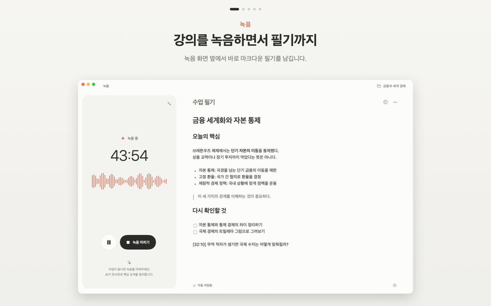
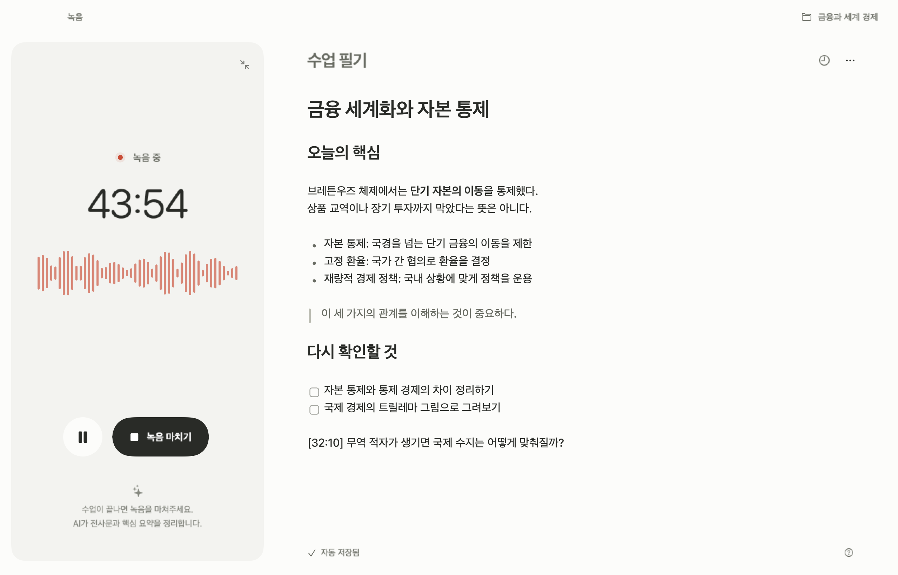
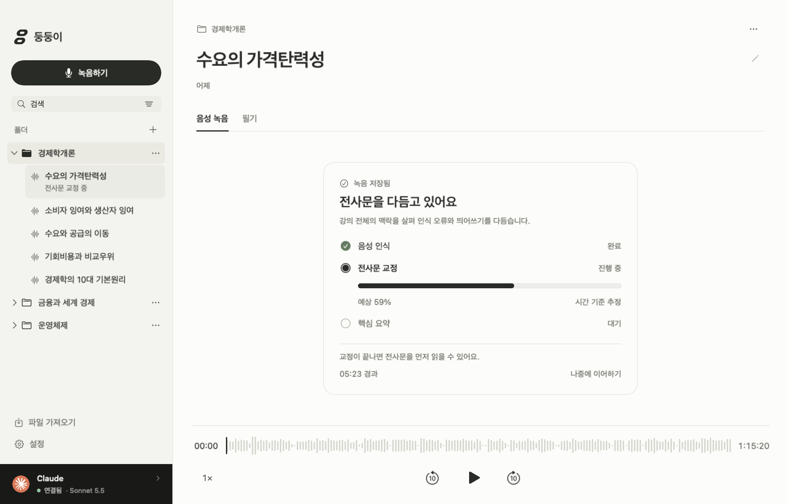
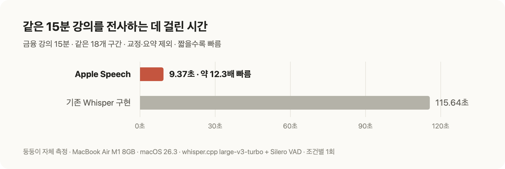
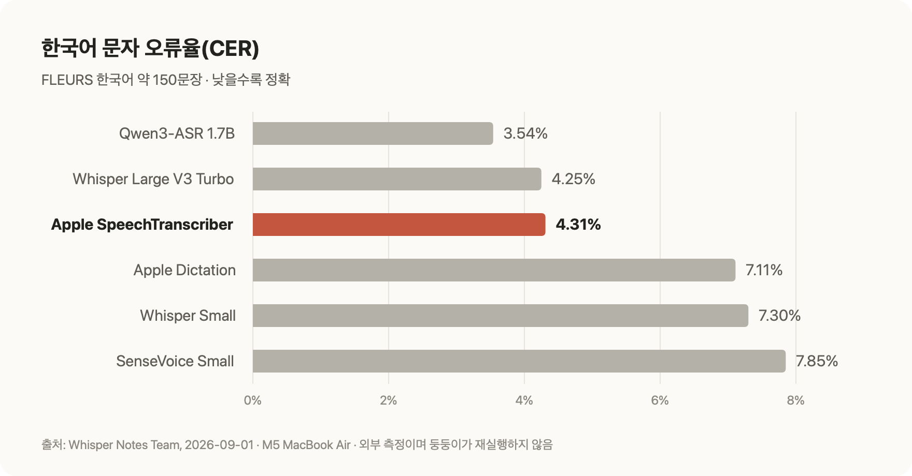
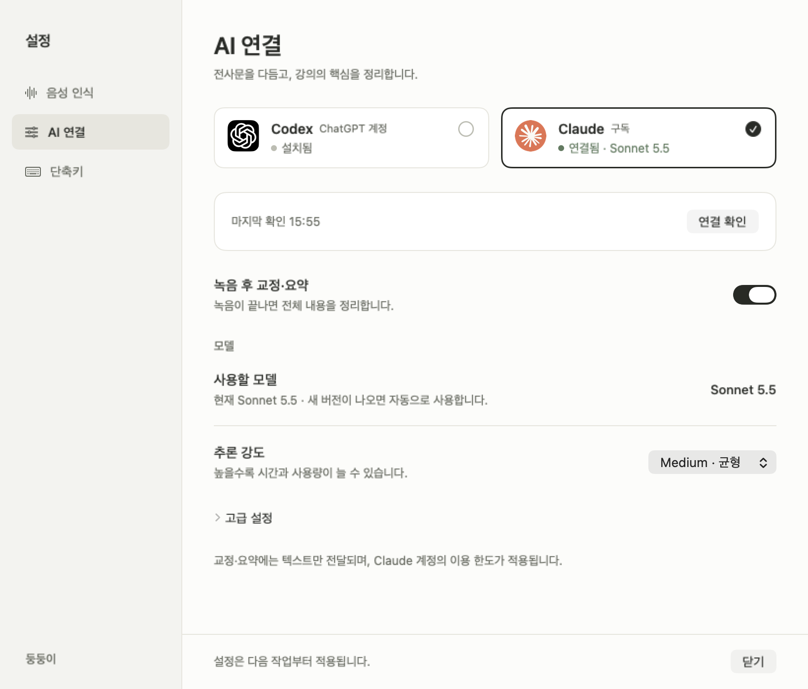

<p align="center">

</p>
<h1 align="center">둥둥이</h1>
<p align="center"><strong>로컬 음성 인식 AI 기반의 대학교 강의 녹음 macOS 앱</strong></p>

**Claude나 Codex를 구독 중인데, 강의 정리하려고 클로바노트·다글로까지 구독하고 계세요?**

둥둥이는 강의 녹음을 Mac 안에서 바로 글로 옮기고, 이미 구독 중인 AI로 다듬고 요약합니다. 새 구독도, 전사 시간 제한도, 분당 요금도 없습니다. 수업 중에는 듣고 필기하는 데만 집중하세요. 나머지는 둥둥이가 정리해 둡니다.



## 녹음 버튼 하나로, 복습할 노트까지

**녹음하며 필기 → 끝나면 AI가 교정·요약 → 문장을 눌러 다시 듣기.** 수업 하나가 이 흐름으로 복습할 수 있는 노트가 됩니다.

### 녹음하면서 바로 필기

녹음을 시작하면 녹음 패널 옆에 필기장이 열립니다. 마크다운으로 적은 필기는 자동 저장되고, 녹음과 함께 과목 폴더에 보관됩니다.



### 끝나면 알아서 정리

녹음을 마치면 음성 인식, 강의 전체 맥락을 살핀 교정, 핵심 요약이 차례로 이어집니다. 지금 어느 단계인지 한눈에 보이고, 중간에 멈춘 정리는 언제든 이어서 처리할 수 있습니다.



### 교수님이 강조한 내용만 카드로

"이건 시험에 나옵니다" 같은 강조와 핵심 개념을 카드로 모아 줍니다. 카드의 **설명 듣기**를 누르면 교수님이 그 내용을 설명한 순간으로 바로 돌아갑니다.


### 읽다가 막히면 그 문장부터 다시 듣기

재생 중인 문장이 가사처럼 따라 강조됩니다. 헷갈리는 문장을 누르면 그 부분부터 다시 듣고, 필요한 글은 골라 복사할 수 있습니다. 한 학기 녹음도 과목 폴더와 검색으로 금방 찾습니다.


## 빠르고 정확한 Mac 내장 음성 인식

전사는 macOS에 내장된 Apple Speech가 Mac 안에서 처리합니다.

### 15분 강의를 약 9초 만에

M1·8GB MacBook Air에서 같은 금융 강의 15분을 같은 18개 구간으로 나눠 비교했습니다. Apple Speech는 **9.37초**, 이전에 쓰던 Whisper 구현은 **115.64초**로 약 **12.3배** 빨랐습니다.



### 한국어 정확도는 Whisper Large V3 Turbo와 비슷하게

공개 한국어 낭독 벤치마크(FLEURS)에서 Apple SpeechTranscriber의 문자 오류율은 **4.31%** 로, Whisper Large V3 Turbo(**4.25%**)와 0.06%p 차이였습니다. Apple의 이전 받아쓰기 모델(7.11%)이나 Whisper Small(7.30%)보다 오류가 적습니다.


### 모델은 macOS가 관리

언어 모델을 한 번 준비해 두면 인터넷 없이도 음성을 인식합니다. 모델 저장과 업데이트는 시스템이 맡으니 따로 내려받고 관리할 필요가 없습니다.

[측정 조건과 선택 근거 자세히 보기](docs/research/apple-speech-selection.ko.md)

## 쓰던 AI 구독 그대로, Codex든 Claude든

교정·요약은 **Codex**(ChatGPT 계정)나 **Claude**(Claude 구독) 중 원하는 쪽으로 처리합니다. API 키 없이 각 CLI에 로그인한 계정을 그대로 쓰고, 계정의 이용 한도 안에서 동작합니다.

설정의 **AI 연결**에서 카드를 누르면 바로 전환됩니다. 한 번 확인한 AI로 돌아올 때는 다시 기다리지 않아도 되고, 이미 진행 중인 정리는 시작할 때의 AI로 끝까지 마칩니다.



AI에는 음성 파일이 아니라 텍스트만 전달됩니다. AI가 연결되지 않아도 녹음은 바로 시작할 수 있고, 정리는 나중에 해도 됩니다. 전사문은 교정이 끝난 뒤에 보여 줍니다.

## 설치

**macOS 26 이상의 Apple Silicon Mac**에서 사용할 수 있습니다. 지금은 소스에서 빌드해 설치합니다. Mac에서 실행 중인 Codex나 Claude Code에 아래 내용을 그대로 붙여넣으세요.

```text
doongdoong-ai/doongdoong 저장소의 둥둥이를 이 Mac에 설치해 줘.
README, docs/technical-guide.ko.md와 설치 스크립트를 읽고 필요한 도구만 준비해 줘.
./scripts/setup-engine.sh와 ./scripts/build-app.sh로 빌드해 ~/Applications에 설치해 줘.
기존 녹음·설정은 보존하고, 실행 중인 앱을 교체하기 전에는 알려 주고 백업해 줘.
언어 모델 준비와 Codex(ChatGPT) 또는 Claude 구독 로그인을 안내해 줘. API 키 결제는 쓰지 마.
테스트·녹음·AI 처리는 실행하지 말고, 설치 후 앱을 백그라운드로 열어 줘.
```

설치가 끝나면 **도움말 → 샘플 녹음으로 둘러보기**로 바로 체험해 보세요.

---

SwiftUI·AppKit으로 만든 네이티브 앱이며, [MIT 라이선스](LICENSE)로 배포합니다.

[빌드·구조·데이터 보관](docs/technical-guide.ko.md) · [평가 기록](docs/validation-apple-transcription.ko.md) · [외부 구성요소](docs/third-party-notices.md)
