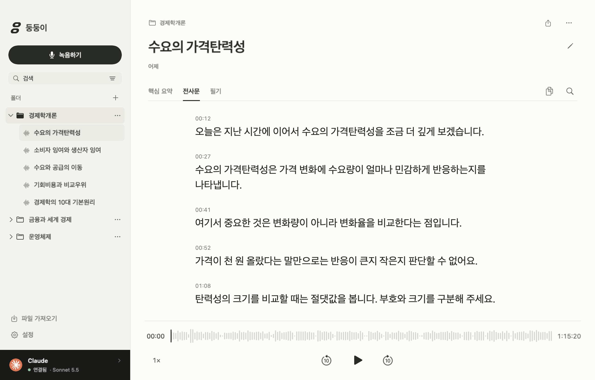

# 붕붕이의 AI 서비스 레퍼런스

공식 제품 자료 10개 서비스를 비교해 **녹음 시작 → 완료된 파일 전사 → 다시 듣고 읽기 → 폴더에 보관**이라는 흐름을 다듬었습니다. 제품 화면은 각 회사가 공개한 스크린샷과 데모를 검토했습니다. 로그인한 서비스의 전체 사용성을 검증한 것은 아닙니다. 아래의 적용 판단은 붕붕이의 목적에 맞춘 해석입니다.

검토일: 2026-10-18. 발표일이 있는 과거 화면과 현재 문서에 게시된 화면을 구분했습니다. 타사 이미지·로고를 붕붕이 자산으로 사용하지 않았습니다.

## 비교한 10개 서비스와 적용한 선택

| 서비스 · 공식 자료 | 확인한 구조와 근거 | 붕붕이에 적용한 판단 |
|---|---|---|
| [Granola 101](https://docs.granola.ai/help-center/getting-started/granola-101) | 공식 화면의 좁은 폴더 사이드바, 제목·메타데이터 중심 기록 행. 스크린샷 확인. | 폴더 → 녹음 → 본문이라는 계층을 유지하고, 목록 미리보기는 한 줄로 제한했습니다. |
| [Superwhisper History](https://superwhisper.com/docs/get-started/history), [인터페이스](https://superwhisper.com/docs/get-started/interface-menu-bar) | 검색 가능한 기록과 기존 녹음 재처리·Finder 접근을 설명합니다. 공식 메뉴 화면 확인. | 녹음 시작을 주 행동으로 두고 재전사·이동·Finder 열기를 항목 메뉴로 모았습니다. |
| [Wispr Flow 기록 관리](https://docs.wisprflow.ai/articles/4465314211-delete-transcripts-and-history-in-wispr-flow), [동작 설명](https://docs.wisprflow.ai/articles/2772472373-what-is-flow) | 기록 행의 컨텍스트 메뉴와 녹음 종료 뒤 완성된 텍스트를 전달하는 흐름을 설명합니다. 문서 기반 검토. | 녹음 중에는 파일을 기록하고 종료 뒤 한 번 전사합니다. 실패한 작업에서 재시도 동작을 보여 줍니다. |
| [Raycast Action Panel](https://developers.raycast.com/api-reference/user-interface/action-panel), [Raycast AI](https://www.raycast.com/core-features/ai) | 현재 항목에 맞는 동작과 단축키를 묶는 구조. 공식 API·제품 문서 기반 검토. | 모든 명령을 화면에 펼치지 않고 메뉴와 단축키로 연결했습니다. 검색·목록 방향키·Enter·Escape 동작을 보강했습니다. |
| [Claude Projects / Artifacts](https://www.anthropic.com/news/projects), [Projects 개편](https://claude.com/resources/articles/projects-redesigned) | 2024-06-25 화면은 대화와 결과물을 나누고 결과물 안에 Preview/Code 전환을 둡니다. 2026-09-17 베타 발표 화면은 작업별 이유와 실행 버튼을 묶습니다. 두 시점의 스크린샷을 구분해 확인. | 주요 읽기 영역을 크게 유지하고, 따라 읽기·전사문 전환을 같은 화면 안에 두었습니다. 보조 메모는 필요할 때 엽니다. |
| [ChatGPT Projects](https://learn.chatgpt.com/docs/projects) | 관련 대화·자료를 프로젝트 안에 모으고 제목 변경·고정·검색으로 다시 찾는 흐름. 공식 문서 기반 검토. | 작업 폴더, 녹음 이름 변경, 즐겨찾기, 제목·전사문·메모 검색을 연결했습니다. |
| [NotebookLM의 3패널 디자인 발표](https://blog.google/innovation-and-ai/models-and-research/google-labs/notebooklm-new-features-december-2024/) | **2024-12-13 발표의 과거 화면**. Sources / Chat / Studio를 나누고 패널을 조절하며 오디오와 문서를 함께 사용합니다. 공식 데모 프레임 확인. | 폴더·목록·읽기 영역을 분리하되 집중 모드에서는 읽기 영역을 확장합니다. 메모를 열어도 재생 맥락을 유지합니다. |
| [Notion AI Meeting Notes](https://www.notion.com/help/guides/preserve-perfect-meeting-memory-with-ai-meeting-notes) | 같은 회의 블록에서 Notes/Transcript 탭과 파형·중지 버튼을 함께 둡니다. 완료 후 같은 위치에 Summary가 더해집니다. 현재 공식 가이드에 게시된 스크린샷 확인, 캡처 날짜는 미표기. | 녹음·전사·메모를 한 작업에 보존합니다. 재생 컨트롤은 본문 하단에서 유지하고, 작업 상태에 맞는 동작만 제공합니다. |
| [Linear Agent](https://linear.app/docs/linear-agent), [Triage Intelligence](https://linear.app/docs/triage-intelligence) | 작은 작업 탭, 날짜별 기록, 작업 제목 근처의 인라인 제안. 현재 공식 문서 스크린샷 확인, 캡처 날짜는 미표기. | 색은 선택·녹음·오류 등 의미 있는 상태에 사용합니다. 처리 상태는 해당 녹음 가까이에 표시하고 목록을 통계 대시보드로 만들지 않았습니다. |
| [Perplexity Projects](https://www.perplexity.ai/en-GB/hub/products/projects) | 공유 파일 시스템과 프로젝트 안의 세션·파일·기억을 연결하는 현재 공개 제품 페이지. 문서·페이지의 UI 예시 기반 검토. | 각 작업 폴더에 오디오와 전사문·메모를 함께 저장하고 Finder에서도 같은 구조를 확인할 수 있게 했습니다. |

## 실제 화면을 바꾼 기준

시작 화면의 장식용 가사 그림, 3단계 설명, 중복 안내를 제거했습니다. 짧은 소개와 녹음·가져오기, 실행 가능한 샘플만 남겼습니다. 보관함은 작은 제목·메타데이터·한 줄 미리보기로 구성하고 검색어가 포함된 부분을 발췌합니다.

읽기 화면에서는 현재 문장과 재생이 중심입니다. 검색창은 요청할 때 열며, 검색 결과만 남기는 대신 앞뒤 문맥을 유지합니다. 문장 편집·반복·복사와 문장 시간은 포인터·키보드 포커스가 있는 문장에서 드러납니다. 기본 화면에서는 상시 시간 열과 아이콘 pill 탭을 제거하고 일반 텍스트 탭을 사용합니다. 전사문 모드는 문장 간 간격을 줄여 빠르게 훑을 수 있게 했습니다.

설정은 왼쪽 내비게이션에서 음성 인식·AI 연결·단축키를 선택합니다. 연결 상태와 자주 쓰는 항목을 먼저 보여 주고, 실행 경로·요청 제한 시간은 접힌 고급 설정에 둡니다. 조작과 선택은 검정·중성 회색으로 통일하고 붉은색은 녹음 상태와 오류에 한정했습니다. 내비게이션 개수나 문장 수처럼 작업에 필요하지 않은 숫자는 표시하지 않습니다.

2026-10-23 설정 개편에서는 [Linear의 Preferences 화면](https://linear.app/docs/account-preferences)을 참고했습니다. 항목 이름·짧은 설명·우측 컨트롤의 정렬을 적용하고, 연결 오류는 상태와 해결 동작을 함께 표시합니다. 핵심 요약은 카드의 제목과 본문을 먼저 읽고, 하단에서 원음 재생·근거 확인·복사를 선택하도록 정리했습니다. 새 녹음 버튼의 세로 여백은 12pt 늘렸으며, 앱에서 저장 폴더를 여는 메뉴와 동작은 제거했습니다.

로고는 두 개의 둥근 `b`와 녹음 점으로 구성했습니다. 어두운 바탕의 앱 아이콘, 단색 심벌, 워드마크는 같은 형태를 사용하며 작은 크기에서도 읽히도록 벡터와 16–1024px 래스터 아이콘을 함께 만들었습니다.

그림 1. 실제 SwiftUI 뷰를 창 없이 메모리에서 렌더링한 화면. 타사 UI 이미지를 합성한 목업이 아닙니다.

## 조작과 작은 상태의 마감

중립색 테마에서도 선택·hover·키보드 포커스를 구별하도록 대비를 조정했습니다. 폴더명은 길어지면 줄이고 툴팁으로 전체 이름을 보여 주며, 비교에 필요한 녹음 길이는 밀리지 않도록 고정합니다. 따라 읽기는 문장 간 여백을 유지하고 전사문은 한글·띄어쓰기 없는 문자열을 줄바꿈합니다. 검색 결과를 표시할 때도 앞뒤 문장은 남습니다.

재생 이동 버튼은 36pt, 문장 작업 버튼은 32pt의 클릭 영역을 제공합니다. 재생 위치의 북마크 상태를 아이콘에 반영하고 반복 클릭은 같은 항목을 추가하지 않습니다. 빈 이름 저장과 실행할 대상이 없는 명령은 비활성화하고, 상세 메뉴의 중복 동작을 정리했습니다. 목록과 문장 자동 스크롤은 macOS의 동작 줄이기 설정을 따릅니다.

## 작업을 방해하지 않는 검증

앱을 강제 활성화하던 코드를 제거했습니다. `--snapshot`은 앱 창을 생성하거나 표시하지 않고 `NSHostingView`를 메모리에 렌더링하며 자동 종료합니다. 텍스트 편집 뷰가 내부적으로 생성하는 보이지 않는 AppKit 창은 별도로 기록합니다. `--integration-report`는 화면 생성 전에 분기합니다. 두 경로는 활성화 정책을 `.prohibited`로 지정합니다. 실제 검증에서 표시된 창 0개, 앱 활성화 없음, 종료 코드 0을 확인했습니다.
